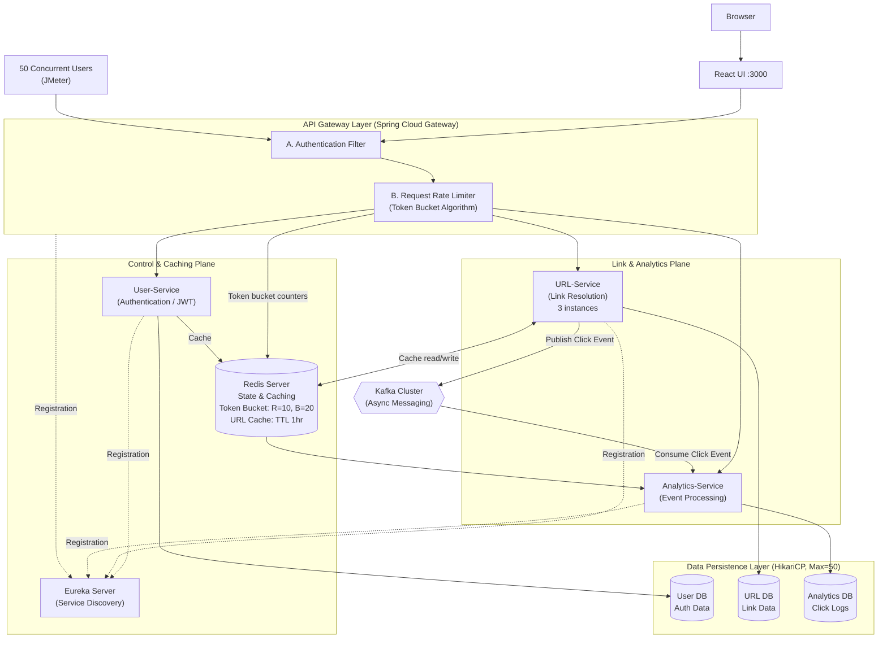

# 🚀 SwiftLink — Distributed URL Shortener Platform


SwiftLink is a production-grade, distributed URL shortening platform designed to handle high traffic, ensure secure authentication, and process analytics asynchronously at scale.
Built using modern backend principles, this project demonstrates microservices architecture, event-driven design, caching, and rate limiting, similar to real-world systems.

---

<p align="center">
  
</p>

---

## 🔥 Key Features
- **🔐 Centralized Authentication Service**
  - Dedicated Security Service for JWT validation across microservices
  - OAuth2 + JWT with HttpOnly cookies for enhanced security
  - Eliminates duplicated auth logic in downstream services
- **⚡ Scalable URL Shortening**
  - Distributed ID generation for unique short codes
  - Designed to avoid collisions across services
- **📊 Event-Driven Analytics**
  - Kafka-based architecture
  - URL Service → produces click events
  - Analytics Service → consumes and processes asynchronously
- **🚀 High Performance with Caching**
  - Redis caching for frequently accessed URLs
  - Reduces database load and improves response time
- **🛡 Rate Limiting**
  - Token Bucket algorithm
  - Configured at API Gateway: 10 req/sec (burst up to 20)
- **🌐 API Gateway (Reactive)**
  - Built with Spring Cloud Gateway (WebFlux)
  - Handles routing, authentication, and rate limiting
- **🔄 Service Discovery**
  - Eureka for dynamic service registration

---

## 🏗️ System Design
### Core Services
- **API Gateway**
  - Entry point for all requests
  - Implements:
    - JWT validation via Security Service
    - Rate limiting
    - Request routing
- **Security Service**
  - Centralized authentication & token validation
  - Shared across all services
- **User Service**
  - User registration and login
- **URL Service**
  - Generates short URLs using distributed ID strategy
  - Publishes events to Kafka
- **Analytics Service**
  - Consumes Kafka events
  - Processes click data asynchronously
- **Service Registry (Eureka)**
  - Enables service discovery and scaling

## ⚙️ Architecture Highlights
- **Microservices + Event-Driven Design**
- **Centralized Security Layer**
- **Redis Caching for Low Latency**
- **Kafka for Async Processing**
- **Rate Limiting for Abuse Prevention**
- **Stateless Services → Horizontal Scaling**

---

## 🛠️ Tech Stack

| Category | Technologies |
|---|---|
| Backend | Java 17, Spring Boot 3.x , Maven |
| Microservices | Spring Cloud: Eureka, Gateway (reactive), OpenFeign |
| Security | Spring Security, OAuth2.O, Authentication/JWT |
| Frontend | React, Axios, React Router, Bootstrap (reactstrap), Sonner / SweetAlert2, Lucide Icons |
| Databases | MySQL (users, url) , MongoDB (analytics), Redis (rate limiting, url cached) |
| DevOps | Docker, Docker Compose, Docker Hub images |

---

## Architecture



## 📁 Project Structure
```Text
url-shortener/
├── backend/
│   ├── api-gateway/
│   ├── service-registry/
│   ├── security-service/
│   ├── user-service/
│   ├── kgs-service/
│   ├── url-service/
│   └── analytics-service/
└── frontend/
    └── url-shortener-ui/
```

---

## 🚀 Getting Started
### Prerequisites
- **Docker Desktop** (8 GB RAM allocated or more is recommended)
- **Git**
- **Node.js and npm** (only if you run the frontend manually)

### 1. Clone the repository
```Bash
git clone https://github.com/Hemant15-Bl/Url-Shortener.git
cd Url-Shortener
```

### 2. Start the application

The startup script launches the services in the order they need (Eureka, Kafka & Redis, Security Service, then the rest):

```bash
# Windows
start-app.bat
```

Or start everything directly with Docker Compose:

```bash
docker-compose up -d
```
**Startup time**

- **8 GB RAM systems:** about **4-5 minutes** with the WSL memory settings optimization. Without them the first boot can take **8-9 minutes**, because 8 or more JVMs start and run database migrations.
- **16 GB+ RAM systems:** expect about **2-3 minutes**.

### 3. Open the application

Once the containers show as healthy in Docker Desktop:

| What | URL |
|---|---|
| Frontend | http://localhost:3000 |
| API Gateway | http://localhost:8084 |
| Eureka dashboard | http://localhost:8761 |

---

## 📈 Future Improvements
- Geo-based analytics
- Custom aliases for URLs
- Multi-region deployment
- Circuit breakers (Resilience4j)
- Kubernetes deployment

---

## 💡 Engineering Decisions
- **Why Kafka?**
  - Decouples analytics from request lifecycle
  - Improves performance and reliability
- **Why Redis?**
  - Reduces DB hits for frequently accessed URLs
- **Why Security Service?**
  - Avoids duplication and centralizes authentication logic
- **Why Rate Limiting?**
  - Protects system from abuse and ensures fair usage

---

## 📸 Screenshots

<table>
  <tr>
    <td align="center" width="50%">
      <br>
      <sub>Sign in</sub>
    </td>
    <td align="center" width="50%">
      <br>
      <sub>Create account</sub>
    </td>
  </tr>
  <tr>
    <td align="center" width="50%">
      <br>
      <sub>Dashboard</sub>
    </td>
    <td align="center" width="50%">
      <br>
      <sub>Analytics Logs</sub>
    </td>
  </tr>
</table>

---

## 👨‍💻 Author
Built by [Hemant15-Bl](https://github.com/Hemant15-Bl). Docker images: [hemantbarole](https://hub.docker.com/u/hemantbarole).

