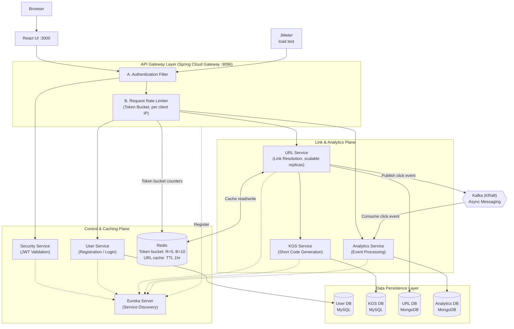

# SwiftLink — Distributed URL Shortener Platform


SwiftLink is a distributed URL shortening platform built around 7 Spring Boot microservices and a React frontend. It uses JWT authentication, Redis caching, gateway-level rate limiting, and Kafka-based asynchronous click analytics. It runs locally with Docker Compose and is also deployed to Kubernetes with ArgoCD (GitOps).

---

<p align="center">
  
</p>

---

## Key Features

- **Centralized authentication:** a dedicated Security Service validates JWTs (OAuth2 + JWT in HttpOnly cookies), so downstream services don't duplicate auth logic.
- **Scalable URL shortening:** a distributed ID strategy generates unique short codes without collisions across service instances.
- **Event-driven analytics:** the URL Service publishes click events to Kafka, and the Analytics Service consumes and stores them asynchronously.
- **Redis caching:** frequently accessed URLs are cached (TTL 1 hour) to reduce database load and latency.
- **Rate limiting:** a Redis-backed token bucket at the gateway, keyed by client IP, with a refill rate of 5 requests/sec and a burst capacity of 10.
- **Reactive API Gateway:** Spring Cloud Gateway (WebFlux) handles routing, authentication, CORS, and rate limiting.
- **Service discovery:** Eureka provides dynamic registration, so services can scale horizontally.

---

## Architecture



### Services

| Service | Port | Responsibility |
|---|---|---|
| **API Gateway** | 9096 | Single entry point: authentication, rate limiting, CORS, routing |
| **Service Registry (Eureka)** | 8761 | Service discovery and registration |
| **Security Service** | 9099 | Centralized JWT validation |
| **User Service** | 9098 | User registration and login (MySQL) |
| **KGS Service** | 9097 | Generates unique short codes (MySQL) |
| **URL Service** | 9094 | Creates and resolves short URLs (MongoDB), caches in Redis, publishes click events |
| **Analytics Service** | 9091 | Consumes click events and stores click logs (MongoDB) |

---

## Tech Stack

| Category | Technologies |
|---|---|
| Backend | Java 17, Spring Boot 3.x, Maven |
| Microservices | Spring Cloud (Eureka, Gateway, OpenFeign) |
| Messaging | Apache Kafka (KRaft mode, no Zookeeper) |
| Security | Spring Security, OAuth2, JWT |
| Frontend | React (Vite), Axios, React Router, Bootstrap (reactstrap), Sonner / SweetAlert2, Lucide Icons |
| Databases | MySQL (users, KGS), MongoDB (URLs, analytics), Redis (rate limiting, URL cache) |
| DevOps | Docker, Docker Compose, Kubernetes, ArgoCD (GitOps), GitHub Actions |
| Testing | Apache JMeter (load testing) |

---

## Project Structure

```text
url-shortener/
├── backend/
│   ├── api-gateway/
│   ├── service-registry/
│   ├── security-service/
│   ├── user-service/
│   ├── kgs-service/
│   ├── url-service/
│   └── analytics-service/
└── frontend/
    └── url-shortener-ui/
├── k8s/                  # Kubernetes manifests (synced by ArgoCD)
└── docker-compose.yml
```

---

## Getting Started

### Prerequisites

- **Docker Desktop** (8 GB RAM or more allocated)
- **Git**
- **Node.js and npm** (only if you run the frontend manually)

### 1. Clone the repository

```bash
git clone https://github.com/Hemant15-Bl/Url-Shortener.git
cd Url-Shortener
```

### 2. Configure secrets

Create a `.env` file next to `docker-compose.yml`, using `.env.example` as a template:

```env
GOOGLE_CLIENT_ID=your-google-client-id
GOOGLE_CLIENT_SECRET=your-google-client-secret
INTERNAL_SECRET=change-me
```

`.env` is git-ignored, so don't commit real credentials.

### 3. Start the application

```bash
# Windows: starts services in the required order
start-app.bat

# Any OS
docker compose up -d
```

**Expected startup time**

| System | First boot |
|---|---|
| 16 GB+ RAM | about 2-3 minutes |
| 8 GB RAM (with WSL memory tuning) | about 4-5 minutes |
| 8 GB RAM (no tuning) | about 8-9 minutes |

Startup is slow on smaller machines because 8 or more JVMs start and run database migrations at once.

### 4. Open the application

| What | URL |
|---|---|
| Frontend | http://localhost:3000 |
| API Gateway | http://localhost:9096 |
| Eureka dashboard | http://localhost:8761 |

### Kubernetes (ArgoCD)

Manifests live in `k8s/` and are synced by ArgoCD. The CI pipeline updates the image tag in the manifests after each build, and ArgoCD rolls the change out. PVCs and their workloads share one sync wave so `WaitForFirstConsumer` volumes bind correctly (see Troubleshooting). Load tests on Kubernetes are planned.

---

## Performance Testing

Load tests were run with Apache JMeter against the Docker Compose deployment on a single local machine (JMeter and the system under test shared the same host). Each virtual user logs in, then requests its URL list using the session cookie. Each user runs once (loop count 1) with a 10 second ramp-up. The gateway rate limiter was active at **refill rate 5 requests/sec, burst capacity 10**, keyed by client IP.

| Run | Users | Requests | Avg latency | Max latency | Throughput | Non-2xx |
|---|---|---|---|---|---|---|
| 1. Baseline | 50 | 100 | 1,872 ms | 8,630 ms | 6.7 req/s | 28% |
| 2. Higher load | 200 | 400 | 4,022 ms | 9,925 ms | 20.0 req/s | 91% |

Per endpoint:

| Run | Endpoint | Samples | Avg | Min | Max | Std dev | Non-2xx | Throughput |
|---|---|---|---|---|---|---|---|---|
| 50 users | Auth-Login | 50 | 3,549 ms | 851 ms | 8,630 ms | 1,835 ms | 28% | 3.4/s |
| 50 users | Get all URLs | 50 | 196 ms | 11 ms | 516 ms | 138 ms | 28% | 3.7/s |
| 200 users | Auth-Login | 200 | 6,718 ms | 1,007 ms | 9,925 ms | 1,826 ms | 91% | 10.3/s |
| 200 users | Get all URLs | 200 | 1,326 ms | 29 ms | 4,375 ms | 1,235 ms | 91% | 10.5/s |

**How to read these results**

- JMeter reports every non-2xx response as an error, so this column includes requests rejected by the rate limiter (HTTP 429). With all virtual users sharing one IP, and therefore one token bucket, a high rejection rate under this load is expected.
- A failed login also leaves that user without a session cookie, so its follow-up request fails too. This is why both endpoints show the same percentage.
- Login is the slowest endpoint at both loads, and the main candidate for tuning.
- The response-code breakdown (429 vs 401 vs 5xx) is not yet recorded, so these runs show overall behavior under load and don't yet prove how many requests were throttled versus failed.

**Next measurements**

- Record the response-code breakdown and p95/p99 latency for successful requests, using JMeter in non-GUI mode (`jmeter -n -t plan.jmx -l results.jtl -e -o report/`).
- Test many distinct clients by sending a different `X-Forwarded-For` per user, to check that normal users aren't throttled.
- Run a capacity test with the limiter relaxed, to find the throughput ceiling of the services.
- Repeat the same plan on Kubernetes and compare with Docker Compose.
- Investigate login latency (password hashing cost, lazy initialization, and the Security and User service hops).

---

## Engineering Decisions

| Decision | Reason |
|---|---|
| **Kafka (KRaft)** | Decouples analytics from the request path. KRaft removes the Zookeeper container and matches the Kubernetes setup |
| **Redis** | Cuts database reads for hot URLs and holds shared rate-limit state across gateway instances |
| **Separate KGS with its own database** | Centralizes short-code generation so scaled-out URL Service instances don't generate duplicates |
| **Security Service** | Centralizes authentication and avoids duplicated logic |
| **Token bucket rate limiting** | Allows short bursts while protecting the system from abuse |
| **Polyglot persistence** | MySQL for relational user and key data, MongoDB for URL documents and click logs |
| **Stateless services** | Enables horizontal scaling behind Eureka |

---

## Troubleshooting

| Issue | Root Cause | Fix |
|---|---|---|
| **PVCs stuck in `Pending` (ArgoCD)** | The StorageClass uses `WaitForFirstConsumer`, but PVCs were in sync-wave 0 while the DB/Kafka workloads were in wave 4. Storage waited for a pod, and ArgoCD waited for the volume. | Put each PVC and its StatefulSet/Deployment in the same wave (`sync-wave: "0"`) so the volume binds when the pod is scheduled. |
| **OOM kills / crash-loops (MongoDB, Kafka)** | Memory limits set below requests (invalid), and unbounded storage-engine caches on a small local VM. | Keep `limits >= requests` (MongoDB: `384Mi` / `512Mi`), cap MongoDB cache with `--wiredTigerCacheSizeGB=0.25`, and set Kafka heap to `-Xms256m -Xmx256m`. |
| **Docker Desktop fails to start** (`io: read/write on closed pipe`) | The experimental `autoMemoryReclaim=dropcache` option was placed under `[wsl2]` in `.wslconfig`, which broke the WSL2 startup handshake. | Move it under `[experimental]`, run `netsh winsock reset`, restart the Host Compute Service (`hns`), then `wsl --shutdown`. |
| **Kafka exits with `InconsistentClusterIdException`** | Zookeeper had no persistent volume, so its cluster ID was regenerated while Kafka's volume kept the old one. | Moved Kafka to KRaft mode (no Zookeeper) and removed the stale Kafka volume once. |

---

## Future Improvements

- Resolve the client IP from `X-Forwarded-For` for rate limiting behind a proxy or Ingress
- Per-user rate limiting in addition to per-IP
- Total click counts on the dashboard
- Geo-based analytics
- Custom aliases for URLs
- Circuit breakers (Resilience4j)
- Multi-region deployment

---

## Screenshots

<table>
  <tr>
    <td align="center" width="50%">
      <br>
      <sub>Sign in</sub>
    </td>
    <td align="center" width="50%">
      <br>
      <sub>Create account</sub>
    </td>
  </tr>
  <tr>
    <td align="center" width="50%">
      <br>
      <sub>Dashboard</sub>
    </td>
    <td align="center" width="50%">
      <br>
      <sub>Analytics logs</sub>
    </td>
  </tr>
</table>

---

## Author

Built by [Hemant15-Bl](https://github.com/Hemant15-Bl). Docker images: [hemantbarole](https://hub.docker.com/u/hemantbarole).

