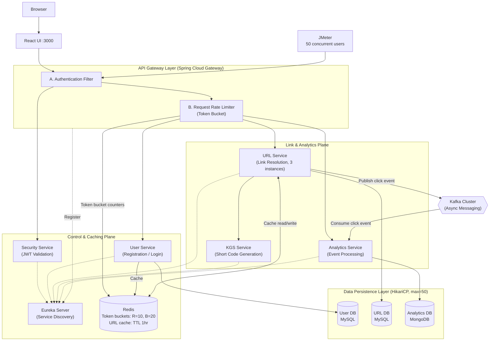

# 🚀 SwiftLink — Distributed URL Shortener Platform


SwiftLink is a production-grade, distributed URL shortening platform designed to handle high traffic, ensure secure authentication, and process analytics asynchronously at scale.
Built using modern backend principles, this project demonstrates microservices architecture, event-driven design, caching, and rate limiting, similar to real-world systems.

---

<p align="center">
  
</p>

---

## Key Features

- **Centralized authentication:** a dedicated Security Service validates JWTs (OAuth2 + JWT in HttpOnly cookies), so downstream services don't duplicate auth logic.
- **Scalable URL shortening:** a distributed ID strategy generates unique short codes without collisions across service instances.
- **Event-driven analytics:** the URL Service publishes click events to Kafka, and the Analytics Service consumes and stores them asynchronously.
- **Redis caching:** frequently accessed URLs are cached (TTL 1 hour) to reduce database load and latency.
- **Rate limiting:** a token bucket at the gateway allows 10 requests/sec with bursts up to 20.
- **Reactive API Gateway:** Spring Cloud Gateway (WebFlux) handles routing, authentication, and rate limiting.
- **Service discovery:** Eureka provides dynamic registration, so services can scale horizontally.

---

## Architecture



### Services

| Service | Responsibility |
|---|---|
| **API Gateway** | Single entry point: JWT validation, rate limiting, routing |
| **Security Service** | Centralized authentication and token validation |
| **User Service** | User registration and login |
| **URL Service** | Creates and resolves short URLs, publishes click events to Kafka |
| **KGS Service** | Generates unique short codes |
| **Analytics Service** | Consumes click events and stores click logs |
| **Service Registry** | Eureka-based discovery and scaling |

---

## Tech Stack

| Category | Technologies |
|---|---|
| Backend | Java 17, Spring Boot 3.x, Maven |
| Microservices | Spring Cloud (Eureka, Gateway, OpenFeign) |
| Messaging | Apache Kafka (KRaft) |
| Security | Spring Security, OAuth2, JWT |
| Frontend | React (Vite), Axios, React Router, Bootstrap (reactstrap), Sonner / SweetAlert2, Lucide Icons |
| Databases | MySQL (users, URLs), MongoDB (analytics), Redis (rate limiting, URL cache) |
| DevOps | Docker, Docker Compose, Kubernetes, ArgoCD (GitOps) |
| Testing | Apache JMeter (load testing) |

---

## Project Structure

```text
url-shortener/
├── backend/
│   ├── api-gateway/
│   ├── service-registry/
│   ├── security-service/
│   ├── user-service/
│   ├── kgs-service/
│   ├── url-service/
│   └── analytics-service/
└── frontend/
    └── url-shortener-ui/
```

---

## Getting Started

### Prerequisites

- **Docker Desktop** (8 GB RAM or more allocated)
- **Git**
- **Node.js and npm** (only if you run the frontend manually)

### 1. Clone the repository

```bash
git clone https://github.com/Hemant15-Bl/Url-Shortener.git
cd Url-Shortener
```

### 2. Start the application

```bash
# Windows: starts services in the required order
# (Eureka, Kafka & Redis, Security Service, then the rest)
start-app.bat

# Any OS
docker compose up -d
```

**Expected startup time**

| System | First boot |
|---|---|
| 16 GB+ RAM | about 2-3 minutes |
| 8 GB RAM (with WSL memory tuning) | about 4-5 minutes |
| 8 GB RAM (no tuning) | about 8-9 minutes |

Startup is slow on smaller machines because 8 or more JVMs start and run database migrations at once.

### 3. Open the application

| What | URL |
|---|---|
| Frontend | http://localhost:3000 |
| API Gateway | http://localhost:8084 |
| Eureka dashboard | http://localhost:8761 |

---

## Engineering Decisions

| Decision | Reason |
|---|---|
| **Kafka** | Decouples analytics from the request lifecycle, improving latency and reliability |
| **Redis** | Cuts database hits for hot URLs and stores shared rate-limit state |
| **Security Service** | Centralizes authentication and avoids duplicated logic |
| **Token bucket rate limiting** | Allows short bursts while protecting the system from abuse |
| **Stateless services** | Enables horizontal scaling behind Eureka |

---

## Troubleshooting

| Issue | Root Cause | Fix |
|---|---|---|
| **PVCs stuck in `Pending` (ArgoCD)** | The StorageClass uses `WaitForFirstConsumer`, but PVCs were in sync-wave 0 while the DB/Kafka workloads were in wave 4. Storage waited for a pod, and ArgoCD waited for the volume. | Put each PVC and its StatefulSet/Deployment in the same wave (`sync-wave: "0"`) so the volume binds when the pod is scheduled. |
| **OOM kills / crash-loops (MongoDB, Kafka)** | Memory limits set below requests (invalid), and unbounded storage-engine caches on a small local VM. | Keep `limits >= requests` (MongoDB: `384Mi` / `512Mi`), cap MongoDB cache with `--wiredTigerCacheSizeGB=0.25`, and set Kafka heap to `-Xms256m -Xmx256m`. |
| **Docker Desktop fails to start** (`io: read/write on closed pipe`) | The experimental `autoMemoryReclaim=dropcache` option was placed under `[wsl2]` in `.wslconfig`, which broke the WSL2 startup handshake. | Move it under `[experimental]`, run `netsh winsock reset`, restart the Host Compute Service (`hns`), then `wsl --shutdown`. |

---

## Future Improvements

- Geo-based analytics
- Custom aliases for URLs
- Multi-region deployment
- Circuit breakers (Resilience4j)

---

## Screenshots

<table>
  <tr>
    <td align="center" width="50%">
      <br>
      <sub>Sign in</sub>
    </td>
    <td align="center" width="50%">
      <br>
      <sub>Create account</sub>
    </td>
  </tr>
  <tr>
    <td align="center" width="50%">
      <br>
      <sub>Dashboard</sub>
    </td>
    <td align="center" width="50%">
      <br>
      <sub>Analytics logs</sub>
    </td>
  </tr>
</table>

---

## Author

Built by [Hemant15-Bl](https://github.com/Hemant15-Bl). Docker images: [hemantbarole](https://hub.docker.com/u/hemantbarole).

